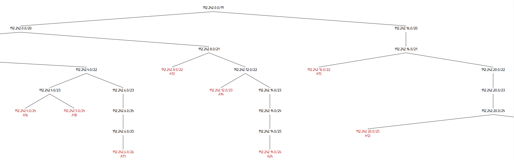
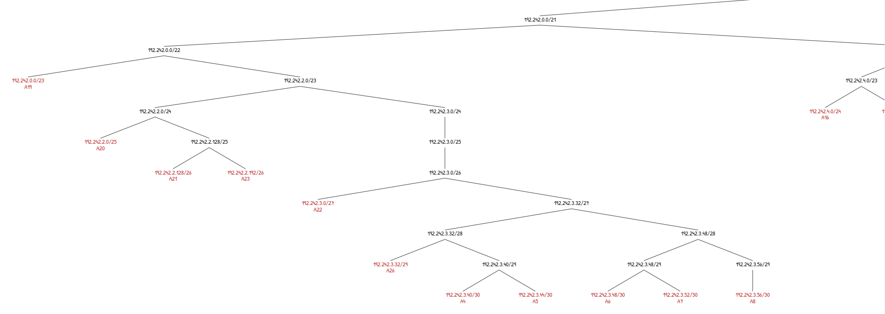
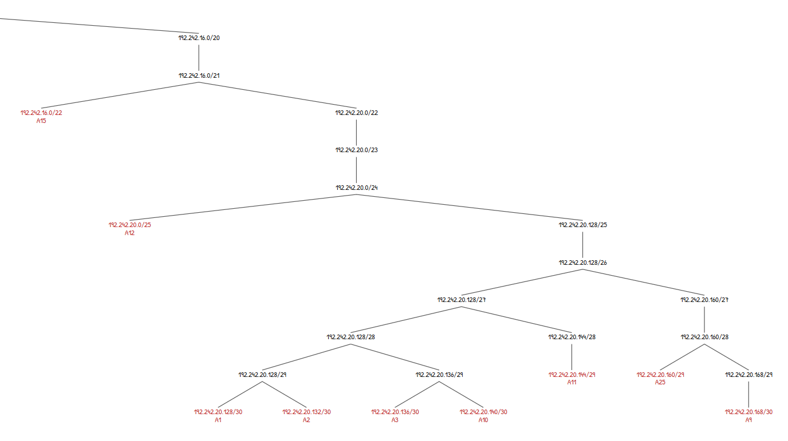
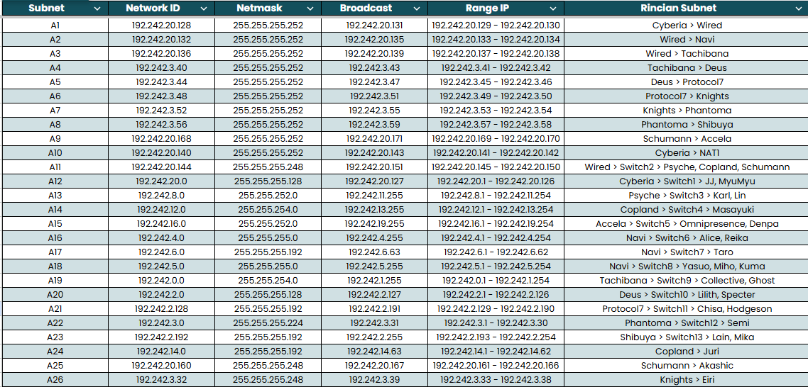
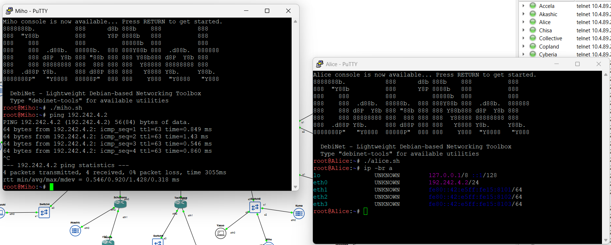
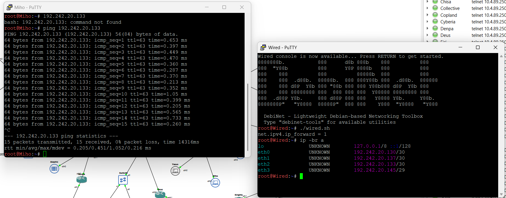
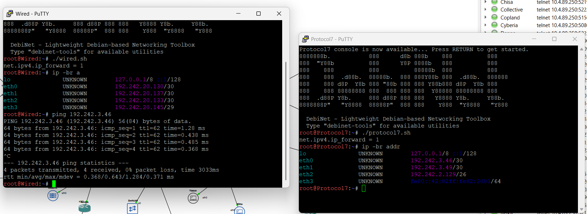
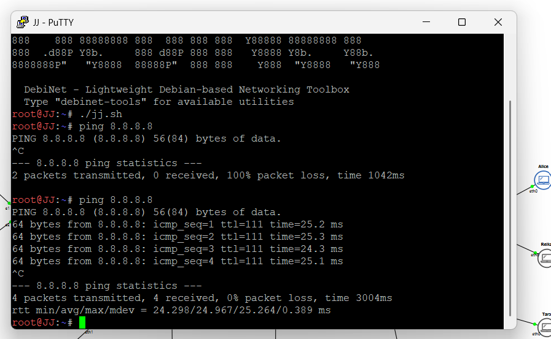

# Jarkom-Modul-4-2026-K-62

| Nama | NRP | Pembagian |
| :--- | :---: | :--- |
| Daffa Ulhaq Fadhlurrahman | 5027251033 | CIDR - GNS3 |
| Michiko Artika Satriyo | 5027251105 | VLSM - CPT |

## Topologi

Topologi dibuat terlebih dahulu sesuai soal, lalu setiap subnet ditandai dengan kode **A1–A26** agar memudahkan pembagian IP. Total terdapat **26 subnet leaf**.

- Topologi VLSM (Cisco Packet Tracer): [`K62_Modul4.pkt`](K62_Modul4.pkt)
- Topologi CIDR (GNS3): [`K-62-MODUL-4.gns3project`](K-62-MODUL-4.gns3project)

## VLSM - Cisco Packet Tracer

### Perhitungan VLSM
Soal nomor 4: 
> Pembagian IP dan routing harus **SEEFISIEN MUNGKIN**.

Tabel VLSM tertera pada [tabel K62_modul4](K62_modul4.xlsx)

#### Menentukan Base Network

Prefix IP kelompok adalah `192.242`, sehingga base network yang digunakan adalah `192.242.0.0`. Alokasi VLSM pada topologi ini memakai base network **`192.242.0.0/19`**. Rincian perhitungan kapasitas prefix `/19` dijelaskan pada [bagian CIDR](#perhitungan-cidr).

#### Langkah-langkahnya:
1. **Subnet diurutkan** dari blok terbesar ke terkecil. Jumlah IP setiap subnet didapat dari jumlah host + jumlah interface router yang berada di subnet itu (ketentuan soal nomor 8). Contoh pada switch3: 700 " 180 + 1 (Psyche) = 881. 
2. Dialokasikan berurutan mulai dari `192.242.0.0`
3. **Contoh perhitungan** untuk A13 (urutan pertama) ke A15 (urutan kedua), dengan prefix `/22` dari A13 yang memiliki 1024 host, dibagi dengan 256 menjadi 4. Maka ditambahkan pada oktet ke-3, dari `192.242.0.0` menjadi `192.242.4.0`.
4. **Contoh perhitungan lainnya** pada prefix yang kecil, dari A12 ke A20 dengan prefix `/25` dari A12 yang memiliki 128 host, bisa langsung ditambahkan ke oktet ke-4, sehingga dari `192.242.14.0` menjadi `192.242.14.128`.
5. Setelah perhitungan network ID selesai, lanjut mengisi kolom **netmask** yang disesuaikan dengan masing-masing prefix.
6. Dilanjutkan dengan mengisi **broadcast** dengan mengurangi 1 host pada network ID berikutnya (broadcast subnet urutan pertama didapat dari network ID subnet urutan ke-2 dikurangi 1, dan begitu selanjutnya).
7. Setelah menghitung broadcast, dilanjut dengan **range IP** dengan menambah 1 host pada network ID dan mengurangi 1 host pada broadcast.

#### Persebaran dan Alokasi IP

Pohon persebaran IP dibuat dengan menempatkan setiap subnet pada blok berikutnya yang masih kosong, dimulai dari base network. Berikut daftar rute setiap subnet beserta hasil alokasi IP VLSM, diurutkan dari kebutuhan terbesar ke terkecil.

| Urutan | Subnet | Rute | Jumlah IP | Prefix | Network ID | Broadcast | Range IP |
|---:|---|---|---:|---|---|---|---|
| 1 | A13 | Psyche > Switch3 > Karl, Lin | 881 | `/22` | `192.242.0.0` | `192.242.3.255` | `192.242.0.1 – 192.242.3.254` |
| 2 | A15 | Accela > Switch5 > Omnipresence, Denpa | 514 | `/22` | `192.242.4.0` | `192.242.7.255` | `192.242.4.1 – 192.242.7.254` |
| 3 | A14 | Copland > Switch4 > Juri, Masayuki | 301 | `/23` | `192.242.8.0` | `192.242.9.255` | `192.242.8.1 – 192.242.9.254` |
| 4 | A19 | Tachibana > Switch9 > Collective, Ghost | 267 | `/23` | `192.242.10.0` | `192.242.11.255` | `192.242.10.1 – 192.242.11.254` |
| 5 | A16 | Navi > Switch6 > Alice, Reika | 254 | `/24` | `192.242.12.0` | `192.242.12.255` | `192.242.12.1 – 192.242.12.254` |
| 6 | A18 | Navi > Switch8 > Yasuo, Miho, Kuma | 143 | `/24` | `192.242.13.0` | `192.242.13.255` | `192.242.13.1 – 192.242.13.254` |
| 7 | A12 | Cyberia > Switch1 > JJ, MyuMyu | 126 | `/25` | `192.242.14.0` | `192.242.14.127` | `192.242.14.1 – 192.242.14.126` |
| 8 | A20 | Deus > Switch10 > Lilith, Specter | 99 | `/25` | `192.242.14.128` | `192.242.14.255` | `192.242.14.129 – 192.242.14.254` |
| 9 | A23 | Shibuya > Switch13 > Lain, Mika | 62 | `/26` | `192.242.15.0` | `192.242.15.63` | `192.242.15.1 – 192.242.15.62` |
| 10 | A17 | Navi > Switch7 > Taro | 58 | `/26` | `192.242.15.64` | `192.242.15.127` | `192.242.15.65 – 192.242.15.126` |
| 11 | A21 | Protocol7 > Switch11 > Chisa, Hodgeson | 33 | `/26` | `192.242.15.128` | `192.242.15.191` | `192.242.15.129 – 192.242.15.190` |
| 12 | A24 | Copland > Juri | 32 | `/26` | `192.242.15.192` | `192.242.15.255` | `192.242.15.193 – 192.242.15.254` |
| 13 | A22 | Phantoma > Switch12 > Semi | 15 | `/27` | `192.242.16.0` | `192.242.16.31` | `192.242.16.1 – 192.242.16.30` |
| 14 | A11 | Wired > Switch2 > Psyche, Copland, Schumann | 4 | `/29` | `192.242.16.32` | `192.242.16.39` | `192.242.16.33 – 192.242.16.38` |
| 15 | A25 | Schumann > Akashic | 4 | `/29` | `192.242.16.40` | `192.242.16.47` | `192.242.16.41 – 192.242.16.46` |
| 16 | A26 | Knights > Eiri | 3 | `/29` | `192.242.16.48` | `192.242.16.55` | `192.242.16.49 – 192.242.16.54` |
| 17 | A1 | Cyberia > Wired | 2 | `/30` | `192.242.16.56` | `192.242.16.59` | `192.242.16.57 – 192.242.16.58` |
| 18 | A2 | Wired > Navi | 2 | `/30` | `192.242.16.60` | `192.242.16.63` | `192.242.16.61 – 192.242.16.62` |
| 19 | A3 | Wired > Tachibana | 2 | `/30` | `192.242.16.64` | `192.242.16.67` | `192.242.16.65 – 192.242.16.66` |
| 20 | A4 | Tachibana > Deus | 2 | `/30` | `192.242.16.68` | `192.242.16.71` | `192.242.16.69 – 192.242.16.70` |
| 21 | A5 | Deus > Protocol7 | 2 | `/30` | `192.242.16.72` | `192.242.16.75` | `192.242.16.73 – 192.242.16.74` |
| 22 | A6 | Protocol7 > Knights | 2 | `/30` | `192.242.16.76` | `192.242.16.79` | `192.242.16.77 – 192.242.16.78` |
| 23 | A7 | Knights > Phantoma | 2 | `/30` | `192.242.16.80` | `192.242.16.83` | `192.242.16.81 – 192.242.16.82` |
| 24 | A8 | Phantoma > Shibuya | 2 | `/30` | `192.242.16.84` | `192.242.16.87` | `192.242.16.85 – 192.242.16.86` |
| 25 | A9 | Schumann > Accela | 2 | `/30` | `192.242.16.88` | `192.242.16.91` | `192.242.16.89 – 192.242.16.90` |
| 26 | A10 | Cyberia > NAT1 | 1 | `/30` | `192.242.16.92` | `192.242.16.95` | `192.242.16.93 – 192.242.16.94` |

#### Mengisi Sisa (Subnet Kecil)

Setelah blok besar ditempatkan, sisa ruang dialokasikan untuk subnet kecil (`/25` sampai `/30`) secara berurutan. Contohnya A12 dan A20 mengisi `192.242.14.0/24`, lalu A23, A17, A21, dan A24 mengisi `192.242.15.0/24`, sebelum A22 (`/27`) serta subnet `/29` dan `/30` ditempatkan mulai `192.242.16.0` hingga `192.242.16.95`.

### Routing

#### interface router
```cisco
enable
configure terminal
interface [port]
ip address [IP_Address] [Subnet_Mask]
no shutdown
exit
```

Konfigurasi lengkap seluruh node VLSM juga tersedia pada [`Script Modul 4 Jarkom.docx`](Script%20Modul%204%20Jarkom.docx).

|  Router | Port | IP Address | Subnet Mask | Interface / Terhubung Ke |
| :--- | :--- | :--- | :--- | :--- |
| **Cyberia** | `fa0/0` | `192.242.16.57` | `255.255.255.252` | Wired |
| | `fa0/1` | `192.242.14.1` | `255.255.255.128` | Switch1 |
| | `fa1/0` | `192.242.16.93` | `255.255.255.252` | NAT1 |
| **Wired** | `fa0/0` | `192.242.16.58` | `255.255.255.252` | Cyberia |
| | `fa0/1` | `192.242.16.65` | `255.255.255.252` | Tachibana |
| | `eth1/0` | `192.242.16.61` | `255.255.255.252` | Navi |
| | `eth1/1` | `192.242.16.33` | `255.255.255.248` | Switch2 |
| **Navi** | `fa0/0` | `192.242.16.62` | `255.255.255.252` | Wired |
| | `fa0/1` | `192.242.12.1` | `255.255.255.0` | Switch6 |
| | `eth1/0` | `192.242.15.65` | `255.255.255.192` | Switch7 |
| | `eth1/1` | `192.242.13.1` | `255.255.255.0` | Switch8 |
| **Tachibana** | `fa0/0` | `192.242.16.66` | `255.255.255.252` | Wired |
| | `fa0/1` | `192.242.16.69` | `255.255.255.252` | Deus |
| | `eth1/0` | `192.242.10.1` | `255.255.254.0` | Switch9 |
| **Deus** | `fa0/0` | `192.242.16.70` | `255.255.255.252` | Tachibana |
| | `fa0/1` | `192.242.16.73` | `255.255.255.252` | Protocol7 |
| | `eth1/0` | `192.242.14.129` | `255.255.255.128` | Switch10 |
| **Protocol7** | `fa0/0` | `192.242.16.74` | `255.255.255.252` | Deus |
| | `fa0/1` | `192.242.16.77` | `255.255.255.252` | Knights |
| | `eth1/0` | `192.242.15.129` | `255.255.255.192` | Switch11 |
| **Knights** | `fa0/0` | `192.242.16.78` | `255.255.255.252` | Protocol7 |
| | `fa0/1` | `192.242.16.81` | `255.255.255.252` | Phantoma |
| | `eth1/0` | `192.242.16.49` | `255.255.255.248` | Eiri |
| **Phantoma** | `fa0/0` | `192.242.16.82` | `255.255.255.252` | Knights |
| | `fa0/1` | `192.242.16.85` | `255.255.255.252` | Shibuya |
| | `eth1/0` | `192.242.16.1` | `255.255.255.224` | Switch12 |
| **Shibuya** | `fa0/0` | `192.242.16.86` | `255.255.255.252` | Phantoma |
| | `fa0/1` | `192.242.15.1` | `255.255.255.192` | Switch13 |
| **Psyche** | `fa0/0` | `192.242.16.34` | `255.255.255.248` | Switch2 |
| | `fa0/1` | `192.242.0.1` | `255.255.252.0` | Switch3 |
| **Copland** | `fa0/0` | `192.242.16.35` | `255.255.255.248` | Switch2 |
| | `fa0/1` | `192.242.8.1` | `255.255.254.0` | Switch4 |
| | `fa1/0` | `192.242.15.193` | `255.255.255.192` | Juri |
| **Schumann** | `fa0/0` | `192.242.16.36` | `255.255.255.248` | Switch2 |
| | `fa0/1` | `192.242.16.89` | `255.255.255.252` | Accela |
| | `fa1/0` | `192.242.16.41` | `255.255.255.248` | Akashic |
| **Accela** | `fa0/0` | `192.242.16.90` | `255.255.255.252` | Schumann |
| | `fa0/1` | `192.242.4.1` | `255.255.252.0` | Switch5 |

#### Node
| Node Client | Switch / Router (W) | IP Address | Subnet Mask | Default Gateway |
| :--- | :--- | :--- | :--- | :--- |
| **JJ** | S1 | `192.242.14.2` | `255.255.255.128` | `192.242.14.1` |
| **MyuMyu** | S1 | `192.242.14.3` | `255.255.255.128` | `192.242.14.1` |
| **Karl** | S3 | `192.242.0.2` | `255.255.252.0` | `192.242.0.1` |
| **Lin** | S3 | `192.242.0.3` | `255.255.252.0` | `192.242.0.1` |
| **Masayuki** | S4 | `192.242.8.2` | `255.255.254.0` | `192.242.8.1` |
| **Omnipresence** | S5 | `192.242.4.2` | `255.255.252.0` | `192.242.4.1` |
| **Denpa** | S5 | `192.242.4.3` | `255.255.252.0` | `192.242.4.1` |
| **Alice** | S6 | `192.242.12.2` | `255.255.255.0` | `192.242.12.1` |
| **Reika** | S6 | `192.242.12.3` | `255.255.255.0` | `192.242.12.1` |
| **Taro** | S7 | `192.242.15.66` | `255.255.255.192` | `192.242.15.65` |
| **Yasuo** | S8 | `192.242.13.2` | `255.255.255.0` | `192.242.13.1` |
| **Miho** | S8 | `192.242.13.3` | `255.255.255.0` | `192.242.13.1` |
| **Kuma** | S8 | `192.242.13.4` | `255.255.255.0` | `192.242.13.1` |
| **Collective** | S9 | `192.242.10.2` | `255.255.254.0` | `192.242.10.1` |
| **Ghost** | S9 | `192.242.10.3` | `255.255.254.0` | `192.242.10.1` |
| **Lilith** | S10 | `192.242.14.130` | `255.255.255.128` | `192.242.14.129` |
| **Specter** | S10 | `192.242.14.131` | `255.255.255.128` | `192.242.14.129` |
| **Chisa** | S11 | `192.242.15.130` | `255.255.255.192` | `192.242.15.129` |
| **Hodgeson** | S11 | `192.242.15.131` | `255.255.255.192` | `192.242.15.129` |
| **Semi** | S12 | `192.242.16.2` | `255.255.255.224` | `192.242.16.1` |
| **Lain** | S13 | `192.242.15.2` | `255.255.255.192` | `192.242.15.1` |
| **Mika** | S13 | `192.242.15.3` | `255.255.255.192` | `192.242.15.1` |
| **Juri** | Copland | `192.242.15.194` | `255.255.255.192` | `192.242.15.193` |
| **Akashic** | Schumann | `192.242.16.42` | `255.255.255.248` | `192.242.16.41` |
| **Eiri** | Knights | `192.242.16.50` | `255.255.255.248` | `192.242.16.49` |

### Default route
**Cyberia**
```
ip route 0.0.0.0 0.0.0.0 fa1/0
ip route 192.242.0.0 255.255.240.0 192.242.16.58
ip route 192.242.16.0 255.255.255.192 192.242.16.58
ip route 192.242.16.64 255.255.255.224 192.242.16.58
```
**Wired**
```cisco
ip route 0.0.0.0 0.0.0.0 192.242.16.57
ip route 192.242.12.0 255.255.254.0 192.242.16.62
ip route 192.242.15.64 255.255.255.192 192.242.16.62
ip route 192.242.10.0 255.255.254.0 192.242.16.66
ip route 192.242.14.128 255.255.255.128 192.242.16.66
ip route 192.242.15.0 255.255.255.192 192.242.16.66
ip route 192.242.15.128 255.255.255.192 192.242.16.66
ip route 192.242.16.0 255.255.255.224 192.242.16.66
ip route 192.242.16.48 255.255.255.240 192.242.16.66
ip route 192.242.16.64 255.255.255.240 192.242.16.66
ip route 192.242.16.80 255.255.255.248 192.242.16.66
ip route 192.242.0.0 255.255.252.0 192.242.16.34
ip route 192.242.8.0 255.255.254.0 192.242.16.35
ip route 192.242.15.192 255.255.255.192 192.242.16.35
ip route 192.242.4.0 255.255.252.0 192.242.16.36
ip route 192.242.16.32 255.255.255.240 192.242.16.36
ip route 192.242.16.88 255.255.255.252 192.242.16.36
```
**Navi**
```cisco
ip route 0.0.0.0 0.0.0.0 192.242.16.61
```
**Tachibana**
```cisco
ip route 0.0.0.0 0.0.0.0 192.242.16.65
ip route 192.242.14.128 255.255.255.128 192.242.16.70
ip route 192.242.15.0 255.255.255.192 192.242.16.70
ip route 192.242.15.128 255.255.255.192 192.242.16.70
ip route 192.242.16.0 255.255.255.224 192.242.16.70
ip route 192.242.16.48 255.255.255.248 192.242.16.70
ip route 192.242.16.64 255.255.255.240 192.242.16.70
ip route 192.242.16.80 255.255.255.248 192.242.16.70
```
**Deus**
```cisco
ip route 0.0.0.0 0.0.0.0 192.242.16.69
ip route 192.242.15.0 255.255.255.192 192.242.16.74
ip route 192.242.15.128 255.255.255.192 192.242.16.74
ip route 192.242.16.0 255.255.255.224 192.242.16.74
ip route 192.242.16.48 255.255.255.248 192.242.16.74
ip route 192.242.16.72 255.255.255.248 192.242.16.74
ip route 192.242.16.80 255.255.255.248 192.242.16.74
```
**Protocol7**
```cisco
ip route 0.0.0.0 0.0.0.0 192.242.16.73
ip route 192.242.15.0 255.255.255.192 192.242.16.78
ip route 192.242.16.0 255.255.255.224 192.242.16.78
ip route 192.242.16.48 255.255.255.248 192.242.16.78
ip route 192.242.16.80 255.255.255.248 192.242.16.78
```
**Knights**
```cisco
ip route 0.0.0.0 0.0.0.0 192.242.16.77
ip route 192.242.15.0 255.255.255.192 192.242.16.82
ip route 192.242.16.0 255.255.255.224 192.242.16.82
ip route 192.242.16.80 255.255.255.248 192.242.16.82
```
**Phantoma**
```cisco
ip route 0.0.0.0 0.0.0.0 192.242.16.81
ip route 192.242.15.0 255.255.255.192 192.242.16.86
```
**Shibuya**
```cisco
ip route 0.0.0.0 0.0.0.0 192.242.16.85
```
**Psyche**
```cisco
ip route 0.0.0.0 0.0.0.0 192.242.16.33
```
**Copland**
```cisco
ip route 0.0.0.0 0.0.0.0 192.242.16.33
```
**Schumann**
```cisco
ip route 0.0.0.0 0.0.0.0 192.242.16.33
ip route 192.242.4.0 255.255.252.0 192.242.16.90
```
**Accela**
```cisco
ip route 0.0.0.0 0.0.0.0 192.242.16.89
```

### Testing
Hanya beberapa yang diuji untuk efisiensi.

1. Dari JJ (PC) ke Shibuya (router)


2. Dari MyuMyu (PC dari router Cyberia - Switch1) ke Taro (PC dari router Wired - Navi - Switch7)


3. Dari Kuma (Server dari router Wired - Navi - Switch8) ke Ghost (PC dari router Tachibana - Switch 9)


4. `ping 8.8.8.8` 


## CIDR - GNS3

### Perhitungan CIDR
Soal nomor 4: 
> Pembagian IP dan routing harus **SEEFISIEN MUNGKIN**.

Tabel CIDR tertera pada [Tabel K62_modul4_CIDR](K62_modul4_CIDR.xlsx)

Prefix IP kelompok adalah `192.242.x.x`, sehingga base network yang digunakan adalah `192.242.0.0`. Total kebutuhan IP seluruh subnet adalah **2.816 IP**, tetapi setelah setiap kebutuhan dibulatkan ke prefix terdekat, total blok *leaf* menjadi **4.192 alamat**. Kapasitas `/20` hanya **4.096 alamat**, sehingga `/20` tidak cukup. Prefix minimum yang mampu menampung seluruh blok leaf adalah **`/19`** dengan kapasitas **8.192 alamat**. Maka base network yang dipakai adalah **`192.242.0.0/19`**.

#### Langkah-langkahnya:
1. **Subnet leaf ditentukan** prefix-nya dari jumlah host + jumlah interface router yang berada pada subnet tersebut (ketentuan soal nomor 8).
2. **Subnet yang bertetangga dan prefix-nya sama digabungkan** menjadi satu blok yang lebih besar (*supernetting*).
3. Penggabungan dilakukan bertahap dari bawah ke atas. Setiap tahap diberi kode **B** (tahap 1), **C** (tahap 2), **D** (tahap 3), dan seterusnya.
4. Penggabungan berlanjut sampai seluruh subnet menyatu menjadi satu blok root `/19`.
5. Dari pohon penggabungan terbentuk **tiga blok `/21`**, lalu ketiganya digabung menjadi root `192.242.0.0/19`.
6. Hasil akhirnya adalah **26 subnet leaf** dengan network ID yang berbeda dari VLSM, tetapi prefix/netmask setiap subnet tetap sama.

**Tabel dan Pohon Penggabungan CIDR**

| Tahap | Subnet Baru | Gabungan 1 | Netmask 1 | Gabungan 2 | Netmask 2 | Netmask Akhir | Network ID |
|---:|---|---|---|---|---|---|---|
| 1 | B1 | A21 | /26 | A23 | /26 | /25 | 192.242.2.128/25 |
| 1 | B2 | A4 | /30 | A5 | /30 | /29 | 192.242.3.40/29 |
| 1 | B3 | A6 | /30 | A7 | /30 | /29 | 192.242.3.48/29 |
| 1 | B4 | A16 | /24 | A18 | /24 | /23 | 192.242.4.0/23 |
| 1 | B5 | A14 | /23 | A24 | /26 | /22 | 192.242.12.0/22 |
| 1 | B6 | A25 | /29 | A9 | /30 | /28 | 192.242.20.160/28 |
| 1 | B7 | A1 | /30 | A2 | /30 | /29 | 192.242.20.128/29 |
| 1 | B8 | A3 | /30 | A10 | /30 | /29 | 192.242.20.136/29 |
| 2 | C1 | A20 | /25 | B1 | /25 | /24 | 192.242.2.0/24 |
| 2 | C2 | B3 | /29 | A8 | /30 | /28 | 192.242.3.48/28 |
| 2 | C3 | A26 | /29 | B2 | /29 | /28 | 192.242.3.32/28 |
| 2 | C4 | B4 | /23 | A17 | /26 | /22 | 192.242.4.0/22 |
| 2 | C5 | B7 | /29 | B8 | /29 | /28 | 192.242.20.128/28 |
| 2 | C6 | C5 | /28 | A11 | /29 | /27 | 192.242.20.128/27 |
| 3 | D1 | C3 | /28 | C2 | /28 | /27 | 192.242.3.32/27 |
| 3 | D2 | C6 | /27 | B6 | /28 | /26 | 192.242.20.128/26 |
| 4 | E1 | A22 | /27 | D1 | /27 | /26 | 192.242.3.0/26 |
| 4 | E2 | A12 | /25 | D2 | /26 | /24 | 192.242.20.0/24 |
| 5 | F1 | C1 | /24 | E1 | /26 | /23 | 192.242.2.0/23 |
| 6 | G1 | A19 | /23 | F1 | /23 | /22 | 192.242.0.0/22 |
| 7 | H1 | G1 | /22 | C4 | /22 | /21 | 192.242.0.0/21 |
| 7 | H2 | A13 | /22 | B5 | /22 | /21 | 192.242.8.0/21 |
| 7 | H3 | A15 | /22 | E2 | /24 | /21 | 192.242.16.0/21 |
| 8 | I1 | H1 | /21 | H2 | /21 | /20 | 192.242.0.0/20 |
| 9 | J1 | I1 | /20 | H3 | /21 | /19 | 192.242.0.0/19 |







**Tabel Hasil Pembagian IP dengan CIDR**



### Routing

#### Interface router
```sh
sysctl -w net.ipv4.ip_forward=1
ip link set [interface] up
ip addr flush dev [interface]
ip addr add [IP_Address]/[prefix] dev [interface]
```

Script konfigurasi lengkap setiap node tersedia di directory [`script-gns3`](script-gns3).

|  Router | Interface | IP Address | Subnet Mask | Interface / Terhubung Ke |
| :--- | :--- | :--- | :--- | :--- |
| **Cyberia** | `eth0` | `192.168.122.250` | `255.255.255.0` | NAT GNS3 |
| | `eth1` | `192.242.20.129` | `255.255.255.252` | Wired |
| | `eth2` | `192.242.20.1` | `255.255.255.128` | Switch1 |
| **Wired** | `eth0` | `192.242.20.130` | `255.255.255.252` | Cyberia |
| | `eth1` | `192.242.20.137` | `255.255.255.252` | Tachibana |
| | `eth2` | `192.242.20.133` | `255.255.255.252` | Navi |
| | `eth3` | `192.242.20.145` | `255.255.255.248` | Switch2 |
| **Navi** | `eth0` | `192.242.20.134` | `255.255.255.252` | Wired |
| | `eth1` | `192.242.4.1` | `255.255.255.0` | Switch6 |
| | `eth2` | `192.242.6.1` | `255.255.255.192` | Switch7 |
| | `eth3` | `192.242.5.1` | `255.255.255.0` | Switch8 |
| **Tachibana** | `eth0` | `192.242.20.138` | `255.255.255.252` | Wired |
| | `eth1` | `192.242.3.41` | `255.255.255.252` | Deus |
| | `eth2` | `192.242.0.1` | `255.255.254.0` | Switch9 |
| **Deus** | `eth0` | `192.242.3.42` | `255.255.255.252` | Tachibana |
| | `eth1` | `192.242.3.45` | `255.255.255.252` | Protocol7 |
| | `eth2` | `192.242.2.1` | `255.255.255.128` | Switch10 |
| **Protocol7** | `eth0` | `192.242.3.46` | `255.255.255.252` | Deus |
| | `eth1` | `192.242.3.49` | `255.255.255.252` | Knights |
| | `eth2` | `192.242.2.129` | `255.255.255.192` | Switch11 |
| **Knights** | `eth0` | `192.242.3.50` | `255.255.255.252` | Protocol7 |
| | `eth1` | `192.242.3.53` | `255.255.255.252` | Phantoma |
| | `eth2` | `192.242.3.33` | `255.255.255.248` | Eiri |
| **Phantoma** | `eth0` | `192.242.3.54` | `255.255.255.252` | Knights |
| | `eth1` | `192.242.3.57` | `255.255.255.252` | Shibuya |
| | `eth2` | `192.242.3.1` | `255.255.255.224` | Switch12 |
| **Shibuya** | `eth0` | `192.242.3.58` | `255.255.255.252` | Phantoma |
| | `eth1` | `192.242.2.193` | `255.255.255.192` | Switch13 |
| **Psyche** | `eth0` | `192.242.20.146` | `255.255.255.248` | Switch2 |
| | `eth1` | `192.242.8.1` | `255.255.252.0` | Switch3 |
| **Copland** | `eth0` | `192.242.20.147` | `255.255.255.248` | Switch2 |
| | `eth1` | `192.242.12.1` | `255.255.254.0` | Switch4 |
| | `eth2` | `192.242.14.1` | `255.255.255.192` | Juri |
| **Schumann** | `eth0` | `192.242.20.148` | `255.255.255.248` | Switch2 |
| | `eth1` | `192.242.20.169` | `255.255.255.252` | Accela |
| | `eth2` | `192.242.20.161` | `255.255.255.248` | Akashic |
| **Accela** | `eth0` | `192.242.20.170` | `255.255.255.252` | Schumann |
| | `eth1` | `192.242.16.1` | `255.255.252.0` | Switch5 |

#### Node
| Node Client | Switch / Router (W) | IP Address | Subnet Mask | Default Gateway |
| :--- | :--- | :--- | :--- | :--- |
| **JJ** | S1 | `192.242.20.2` | `255.255.255.128` | `192.242.20.1` |
| **MyuMyu** | S1 | `192.242.20.3` | `255.255.255.128` | `192.242.20.1` |
| **Karl** | S3 | `192.242.8.2` | `255.255.252.0` | `192.242.8.1` |
| **Lin** | S3 | `192.242.8.3` | `255.255.252.0` | `192.242.8.1` |
| **Masayuki** | S4 | `192.242.12.2` | `255.255.254.0` | `192.242.12.1` |
| **Omnipresence** | S5 | `192.242.16.2` | `255.255.252.0` | `192.242.16.1` |
| **Denpa** | S5 | `192.242.16.3` | `255.255.252.0` | `192.242.16.1` |
| **Alice** | S6 | `192.242.4.2` | `255.255.255.0` | `192.242.4.1` |
| **Reika** | S6 | `192.242.4.3` | `255.255.255.0` | `192.242.4.1` |
| **Taro** | S7 | `192.242.6.2` | `255.255.255.192` | `192.242.6.1` |
| **Yasuo** | S8 | `192.242.5.2` | `255.255.255.0` | `192.242.5.1` |
| **Miho** | S8 | `192.242.5.3` | `255.255.255.0` | `192.242.5.1` |
| **Kuma** | S8 | `192.242.5.4` | `255.255.255.0` | `192.242.5.1` |
| **Collective** | S9 | `192.242.0.2` | `255.255.254.0` | `192.242.0.1` |
| **Ghost** | S9 | `192.242.0.3` | `255.255.254.0` | `192.242.0.1` |
| **Lilith** | S10 | `192.242.2.2` | `255.255.255.128` | `192.242.2.1` |
| **Specter** | S10 | `192.242.2.3` | `255.255.255.128` | `192.242.2.1` |
| **Chisa** | S11 | `192.242.2.130` | `255.255.255.192` | `192.242.2.129` |
| **Hodgeson** | S11 | `192.242.2.131` | `255.255.255.192` | `192.242.2.129` |
| **Semi** | S12 | `192.242.3.2` | `255.255.255.224` | `192.242.3.1` |
| **Lain** | S13 | `192.242.2.194` | `255.255.255.192` | `192.242.2.193` |
| **Mika** | S13 | `192.242.2.195` | `255.255.255.192` | `192.242.2.193` |
| **Juri** | Copland | `192.242.14.2` | `255.255.255.192` | `192.242.14.1` |
| **Akashic** | Schumann | `192.242.20.162` | `255.255.255.248` | `192.242.20.161` |
| **Eiri** | Knights | `192.242.3.34` | `255.255.255.248` | `192.242.3.33` |

### Default route
**Cyberia**
```sh
ip route replace default via 192.168.122.1 dev eth0
ip route replace 192.242.0.0/19 via 192.242.20.130 dev eth1
```
**Wired**
```sh
ip route replace default via 192.242.20.129 dev eth0
ip route replace 192.242.0.0/22 via 192.242.20.138 dev eth1
ip route replace 192.242.4.0/22 via 192.242.20.134 dev eth2
ip route replace 192.242.8.0/22 via 192.242.20.146 dev eth3
ip route replace 192.242.12.0/22 via 192.242.20.147 dev eth3
ip route replace 192.242.16.0/22 via 192.242.20.148 dev eth3
ip route replace 192.242.20.160/28 via 192.242.20.148 dev eth3
```
**Navi**
```sh
ip route replace default via 192.242.20.133 dev eth0
```
**Tachibana**
```sh
ip route replace default via 192.242.20.137 dev eth0
ip route replace 192.242.2.0/23 via 192.242.3.42 dev eth1
```
**Deus**
```sh
ip route replace default via 192.242.3.41 dev eth0
ip route replace 192.242.2.0/23 via 192.242.3.46 dev eth1
```
**Protocol7**
```sh
ip route replace default via 192.242.3.45 dev eth0
ip route replace 192.242.3.0/26 via 192.242.3.50 dev eth1
ip route replace 192.242.2.192/26 via 192.242.3.50 dev eth1
ip route replace 192.242.3.40/30 via 192.242.3.45 dev eth0
```
**Knights**
```sh
ip route replace default via 192.242.3.49 dev eth0
ip route replace 192.242.3.0/26 via 192.242.3.54 dev eth1
ip route replace 192.242.2.192/26 via 192.242.3.54 dev eth1
ip route replace 192.242.3.40/30 via 192.242.3.49 dev eth0
ip route replace 192.242.3.44/30 via 192.242.3.49 dev eth0
```
**Phantoma**
```sh
ip route replace default via 192.242.3.53 dev eth0
ip route replace 192.242.2.192/26 via 192.242.3.58 dev eth1
```
**Shibuya**
```sh
ip route replace default via 192.242.3.57 dev eth0
```
**Psyche**
```sh
ip route replace default via 192.242.20.145 dev eth0
```
**Copland**
```sh
ip route replace default via 192.242.20.145 dev eth0
```
**Schumann**
```sh
ip route replace default via 192.242.20.145 dev eth0
ip route replace 192.242.16.0/22 via 192.242.20.170 dev eth1
```
**Accela**
```sh
ip route replace default via 192.242.20.169 dev eth0
```

### Testing

1. Dari Miho (PC) ke Alice (PC)



2. Dari Miho (PC) ke Wired (Router)



3. Dari Wired (Router) ke Protocol7 (Router)



4. Dari JJ (PC) ke Internet (google.com/8.8.8.8)


