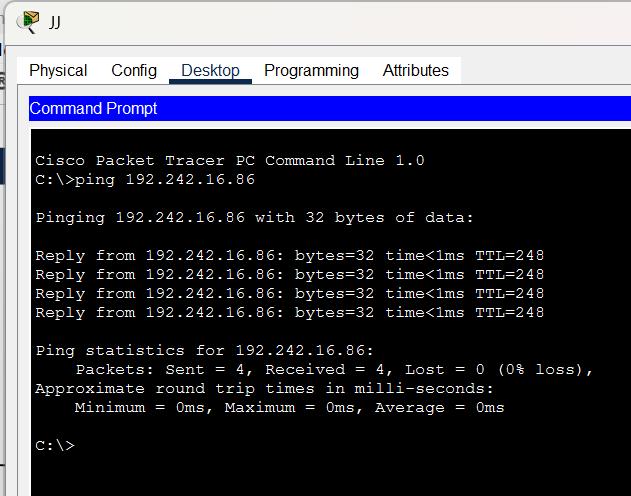
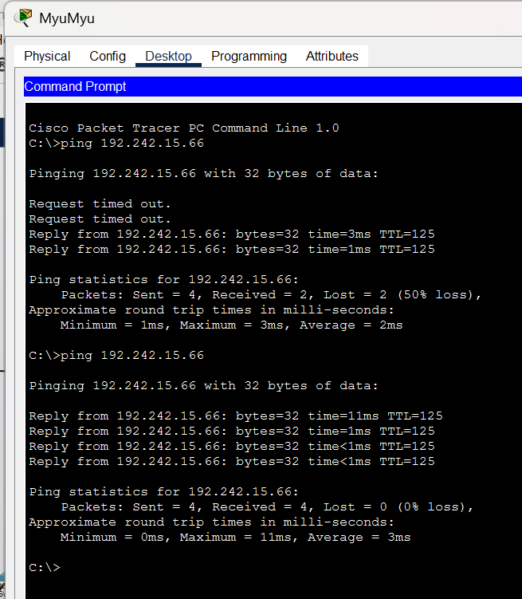
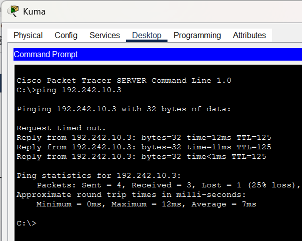
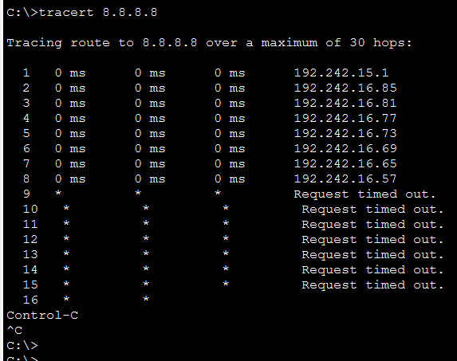

# Jarkom-Modul-4-2026-K-62

| Nama | NRP |
| :--- | :---: |
| Daffa Ulhaq Fadhlurrahman | 5027251033 |
| Michiko Artika Satriyo | 5027251105 |

## VLSM - Cisco Packet Tracer

### Perhitungan VLSM
Soal nomor 4: 
> Pembagian IP dan routing harus **SEEFISIEN MUNGKIN**.

Tabel VLSM tertera pada [tabel K62_modul4](K62_modul4.xlsx)

#### Langkah-langkahnya:
1. **Subnet diurutkan** dari blok terbesar ke terkecil. Jumlah IP setiap subnet didapat dari jumlah host + jumlah interface router yang berada di subnet itu (ketentuan soal nomor 8). Contoh pada switch3: 700 " 180 + 1 (Psyche) = 881. 
2. Dialokasikan berurutan mulai dari `192.242.0.0`
3. **Contoh perhitungan** untuk A13 (urutan pertama) ke A15 (urutan kedua), dengan prefix `/22` dari A13 yang memiliki 1024 host, dibagi dengan 256 menjadi 4. Maka ditambahkan pada oktet ke-3, dari `192.242.0.0` menjadi `192.242.4.0`.
4. **Contoh perhitungan lainnya** pada prefix yang kecil, dari A12 ke A20 dengan prefix `/25` dari A12 yang memiliki 128 host, bisa langsung ditambahkan ke oktet ke-4, sehingga dari `192.242.14.0` menjadi `192.242.14.128`.
5. Setelah perhitungan network ID selesai, lanjut mengisi kolom **netmask** yang disesuaikan dengan masing-masing prefix.
6. Dilanjutkan dengan mengisi **broadcast** dengan mengurangi 1 host pada network ID berikutnya (broadcast subnet urutan pertama didapat dari network ID subnet urutan ke-2 dikurangi 1, dan begitu selanjutnya).
7. Setelah menghitung broadcast, dilanjut dengan **range IP** dengan menambah 1 host pada network ID dan mengurangi 1 host pada broadcast.

### Routing

#### interface router
```cisco
enable
configure terminal
interface [port]
ip address [IP_Address] [Subnet_Mask]
no shutdown
exit
```

|  Router | Port | IP Address | Subnet Mask | Interface / Terhubung Ke |
| :--- | :--- | :--- | :--- | :--- |
| **Cyberia** | `fa0/0` | `192.242.16.57` | `255.255.255.252` | Wired |
| | `fa0/1` | `192.242.14.1` | `255.255.255.128` | Switch1 |
| | `fa1/0` | `192.242.16.93` | `255.255.255.252` | NAT1 |
| **Wired** | `fa0/0` | `192.242.16.58` | `255.255.255.252` | Cyberia |
| | `fa0/1` | `192.242.16.65` | `255.255.255.252` | Tachibana |
| | `eth1/0` | `192.242.16.61` | `255.255.255.252` | Navi |
| | `eth1/1` | `192.242.16.33` | `255.255.255.248` | Switch2 |
| **Navi** | `fa0/0` | `192.242.16.62` | `255.255.255.252` | Wired |
| | `fa0/1` | `192.242.12.1` | `255.255.255.0` | Switch6 |
| | `eth1/0` | `192.242.15.65` | `255.255.255.192` | Switch7 |
| | `eth1/1` | `192.242.13.1` | `255.255.255.0` | Switch8 |
| **Tachibana** | `fa0/0` | `192.242.16.66` | `255.255.255.252` | Wired |
| | `fa0/1` | `192.242.16.69` | `255.255.255.252` | Deus |
| | `eth1/0` | `192.242.10.1` | `255.255.254.0` | Switch9 |
| **Deus** | `fa0/0` | `192.242.16.70` | `255.255.255.252` | Tachibana |
| | `fa0/1` | `192.242.16.73` | `255.255.255.252` | Protocol7 |
| | `eth1/0` | `192.242.14.129` | `255.255.255.128` | Switch10 |
| **Protocol7** | `fa0/0` | `192.242.16.74` | `255.255.255.252` | Deus |
| | `fa0/1` | `192.242.16.77` | `255.255.255.252` | Knights |
| | `eth1/0` | `192.242.15.129` | `255.255.255.192` | Switch11 |
| **Knights** | `fa0/0` | `192.242.16.78` | `255.255.255.252` | Protocol7 |
| | `fa0/1` | `192.242.16.81` | `255.255.255.252` | Phantoma |
| | `eth1/0` | `192.242.16.49` | `255.255.255.248` | Eiri |
| **Phantoma** | `fa0/0` | `192.242.16.82` | `255.255.255.252` | Knights |
| | `fa0/1` | `192.242.16.85` | `255.255.255.252` | Shibuya |
| | `eth1/0` | `192.242.16.1` | `255.255.255.224` | Switch12 |
| **Shibuya** | `fa0/0` | `192.242.16.86` | `255.255.255.252` | Phantoma |
| | `fa0/1` | `192.242.15.1` | `255.255.255.192` | Switch13 |
| **Psyche** | `fa0/0` | `192.242.16.34` | `255.255.255.248` | Switch2 |
| | `fa0/1` | `192.242.0.1` | `255.255.252.0` | Switch3 |
| **Copland** | `fa0/0` | `192.242.16.35` | `255.255.255.248` | Switch2 |
| | `fa0/1` | `192.242.8.1` | `255.255.254.0` | Switch4 |
| | `fa1/0` | `192.242.15.193` | `255.255.255.192` | Juri |
| **Schumann** | `fa0/0` | `192.242.16.36` | `255.255.255.248` | Switch2 |
| | `fa0/1` | `192.242.16.89` | `255.255.255.252` | Accela |
| | `fa1/0` | `192.242.16.41` | `255.255.255.248` | Akashic |
| **Accela** | `fa0/0` | `192.242.16.90` | `255.255.255.252` | Schumann |
| | `fa0/1` | `192.242.4.1` | `255.255.252.0` | Switch5 |

#### Node
| Node Client | Switch / Router (W) | IP Address | Subnet Mask | Default Gateway |
| :--- | :--- | :--- | :--- | :--- |
| **JJ** | S1 | `192.242.14.2` | `255.255.255.128` | `192.242.14.1` |
| **MyuMyu** | S1 | `192.242.14.3` | `255.255.255.128` | `192.242.14.1` |
| **Karl** | S3 | `192.242.0.2` | `255.255.252.0` | `192.242.0.1` |
| **Lin** | S3 | `192.242.0.3` | `255.255.252.0` | `192.242.0.1` |
| **Masayuki** | S4 | `192.242.8.2` | `255.255.254.0` | `192.242.8.1` |
| **Omnipresence** | S5 | `192.242.4.2` | `255.255.252.0` | `192.242.4.1` |
| **Denpa** | S5 | `192.242.4.3` | `255.255.252.0` | `192.242.4.1` |
| **Alice** | S6 | `192.242.12.2` | `255.255.255.0` | `192.242.12.1` |
| **Reika** | S6 | `192.242.12.3` | `255.255.255.0` | `192.242.12.1` |
| **Taro** | S7 | `192.242.15.66` | `255.255.255.192` | `192.242.15.65` |
| **Yasuo** | S8 | `192.242.13.2` | `255.255.255.0` | `192.242.13.1` |
| **Miho** | S8 | `192.242.13.3` | `255.255.255.0` | `192.242.13.1` |
| **Kuma** | S8 | `192.242.13.4` | `255.255.255.0` | `192.242.13.1` |
| **Collective** | S9 | `192.242.10.2` | `255.255.254.0` | `192.242.10.1` |
| **Ghost** | S9 | `192.242.10.3` | `255.255.254.0` | `192.242.10.1` |
| **Lilith** | S10 | `192.242.14.130` | `255.255.255.128` | `192.242.14.129` |
| **Specter** | S10 | `192.242.14.131` | `255.255.255.128` | `192.242.14.129` |
| **Chisa** | S11 | `192.242.15.130` | `255.255.255.192` | `192.242.15.129` |
| **Hodgeson** | S11 | `192.242.15.131` | `255.255.255.192` | `192.242.15.129` |
| **Semi** | S12 | `192.242.16.2` | `255.255.255.224` | `192.242.16.1` |
| **Lain** | S13 | `192.242.15.2` | `255.255.255.192` | `192.242.15.1` |
| **Mika** | S13 | `192.242.15.3` | `255.255.255.192` | `192.242.15.1` |
| **Juri** | Copland | `192.242.15.194` | `255.255.255.192` | `192.242.15.193` |
| **Akashic** | Schumann | `192.242.16.42` | `255.255.255.248` | `192.242.16.41` |
| **Eiri** | Knights | `192.242.16.50` | `255.255.255.248` | `192.242.16.49` |

### Default route
**Cyberia**
```
ip route 0.0.0.0 0.0.0.0 fa1/0
ip route 192.242.0.0 255.255.240.0 192.242.16.58
ip route 192.242.16.0 255.255.255.192 192.242.16.58
ip route 192.242.16.64 255.255.255.224 192.242.16.58
```
**Wired**
```cisco
ip route 0.0.0.0 0.0.0.0 192.242.16.57
ip route 192.242.12.0 255.255.254.0 192.242.16.62
ip route 192.242.15.64 255.255.255.192 192.242.16.62
ip route 192.242.10.0 255.255.254.0 192.242.16.66
ip route 192.242.14.128 255.255.255.128 192.242.16.66
ip route 192.242.15.0 255.255.255.192 192.242.16.66
ip route 192.242.15.128 255.255.255.192 192.242.16.66
ip route 192.242.16.0 255.255.255.224 192.242.16.66
ip route 192.242.16.48 255.255.255.240 192.242.16.66
ip route 192.242.16.64 255.255.255.240 192.242.16.66
ip route 192.242.16.80 255.255.255.248 192.242.16.66
ip route 192.242.0.0 255.255.252.0 192.242.16.34
ip route 192.242.8.0 255.255.254.0 192.242.16.35
ip route 192.242.15.192 255.255.255.192 192.242.16.35
ip route 192.242.4.0 255.255.252.0 192.242.16.36
ip route 192.242.16.32 255.255.255.240 192.242.16.36
ip route 192.242.16.88 255.255.255.252 192.242.16.36
```
**Navi**
```cisco
ip route 0.0.0.0 0.0.0.0 192.242.16.61
```
**Tachibana**
```cisco
ip route 0.0.0.0 0.0.0.0 192.242.16.65
ip route 192.242.14.128 255.255.255.128 192.242.16.70
ip route 192.242.15.0 255.255.255.192 192.242.16.70
ip route 192.242.15.128 255.255.255.192 192.242.16.70
ip route 192.242.16.0 255.255.255.224 192.242.16.70
ip route 192.242.16.48 255.255.255.248 192.242.16.70
ip route 192.242.16.64 255.255.255.240 192.242.16.70
ip route 192.242.16.80 255.255.255.248 192.242.16.70
```
**Deus**
```cisco
ip route 0.0.0.0 0.0.0.0 192.242.16.69
ip route 192.242.15.0 255.255.255.192 192.242.16.74
ip route 192.242.15.128 255.255.255.192 192.242.16.74
ip route 192.242.16.0 255.255.255.224 192.242.16.74
ip route 192.242.16.48 255.255.255.248 192.242.16.74
ip route 192.242.16.72 255.255.255.248 192.242.16.74
ip route 192.242.16.80 255.255.255.248 192.242.16.74
```
**Protocol7**
```cisco
ip route 0.0.0.0 0.0.0.0 192.242.16.73
ip route 192.242.15.0 255.255.255.192 192.242.16.78
ip route 192.242.16.0 255.255.255.224 192.242.16.78
ip route 192.242.16.48 255.255.255.248 192.242.16.78
ip route 192.242.16.80 255.255.255.248 192.242.16.78
```
**Knights**
```cisco
ip route 0.0.0.0 0.0.0.0 192.242.16.77
ip route 192.242.15.0 255.255.255.192 192.242.16.82
ip route 192.242.16.0 255.255.255.224 192.242.16.82
ip route 192.242.16.80 255.255.255.248 192.242.16.82
```
**Phantoma**
```cisco
ip route 0.0.0.0 0.0.0.0 192.242.16.81
ip route 192.242.15.0 255.255.255.192 192.242.16.86
```
**Shibuya**
```cisco
ip route 0.0.0.0 0.0.0.0 192.242.16.85
```
**Psyche**
```cisco
ip route 0.0.0.0 0.0.0.0 192.242.16.33
```
**Copland**
```cisco
ip route 0.0.0.0 0.0.0.0 192.242.16.33
```
**Schumann**
```cisco
ip route 0.0.0.0 0.0.0.0 192.242.16.33
ip route 192.242.4.0 255.255.252.0 192.242.16.90
```
**Accela**
```cisco
ip route 0.0.0.0 0.0.0.0 192.242.16.89
```

### Testing
Hanya beberapa yang diuji untuk efisiensi.

1. Dari JJ (PC) ke Shibuya (router)



2. Dari MyuMyu (PC dari router Cyberia - Switch1) ke Taro (PC dari router Wired - Navi - Switch7)



3. Dari Kuma (Server dari router Wired - Navi - Switch8) ke Ghost (PC dari router Tachibana - Switch 9)



4. `ping 8.8.8.8` 



## CIDR - GNS3